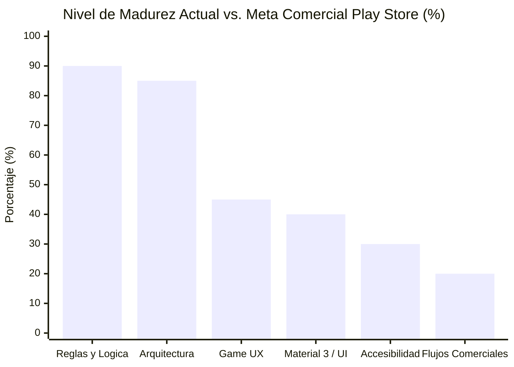

# Software Design Document (SDD): Flutter Peg Solitaire (Google Play Store Readiness)

> **Proyecto:** Flutter Peg Solitaire (Solitario Inglés)  
> **Application ID:** `cl.mmoscoso.pegsolitaire`  
> **Framework:** Flutter (Dart SDK ^3.13.0)  
> **Target OS:** Android (Google Play Store compliance)

---

## 1. Visión General del Proyecto y Diagnóstico

Este documento compila el diseño de especificación y arquitectura técnica para elevar el proyecto **Flutter Peg Solitaire** al estándar exigido por Google Play Store en términos de publicación técnica, usabilidad (UX), calidad visual (Material Design 3), accesibilidad (WCAG) y flujos comerciales.

### Diagnóstico de Madurez Actual

---

## 2. Plan Maestro de Despliegue en Google Play (Requisitos de Plataforma Android)

### 2.1. Firma Criptográfica de Producción (Release Signing)
- Reemplazo de `signingConfigs.getByName("debug")` en `android/app/build.gradle.kts`.
- Implementación de `key.properties` y Keystore PKCS12 (`upload-keystore.jks`) fuera del control de versiones (`.gitignore`).

### 2.2. Optimización y Reducción de Código (R8 / ProGuard)
- Activación de `isMinifyEnabled = true` e `isShrinkResources = true`.
- Creación de `android/app/proguard-rules.pro` para proteger clases de Flutter, plugins de audio y modelos de reflexión.

### 2.3. Manifiesto y Compatibilidad de Hardware
- Declaración en `android/app/src/main/AndroidManifest.xml`:
  `<uses-feature android:name="android.hardware.sensor.accelerometer" android:required="false" />`
  para permitir descargas en tablets y dispositivos sin acelerómetro.

### 2.4. Iconos Adaptativos y Splash Screen
- Configuración de iconos adaptativos (`adaptive_icon_background` y `adaptive_icon_foreground`) en `pubspec.yaml` mediante `flutter_launcher_icons`.
- Soporte para la API de Splash Screen de Android 12+.

### 2.5. Artefacto de Distribución y Políticas
- Generación de Android App Bundle (`.aab`): `flutter build appbundle --release`.
- Formulario de Seguridad de Datos (*Data Safety Form*) y URL de Política de Privacidad pública.

---

## 3. Hoja de Ruta de Sprints de Usabilidad y Buenas Prácticas

El trabajo de mejora se organiza en 4 sprints modulares contenidos en la carpeta `conductor/`:

| Sprint | Archivo | Alcance Principal |
| :--- | :--- | :--- |
| **Sprint 1** | [`conductor/sprint-1-screens-flows.md`](file:///Users/manuel/Documents/flutter_projects/3479A321_202602/flutter_pegsolitaire/conductor/sprint-1-screens-flows.md) | Pantalla de Ajustes (`SettingsScreen`), modal "Acerca de", confirmación de salida con `PopScope` y modal de fin de partida. |
| **Sprint 2** | [`conductor/sprint-2-game-ux.md`](file:///Users/manuel/Documents/flutter_projects/3479A321_202602/flutter_pegsolitaire/conductor/sprint-2-game-ux.md) | Deshacer movimientos (`undo`), resaltado visual de movimientos válidos, cronómetro visible y persistencia de partida. |
| **Sprint 3** | [`conductor/sprint-3-ui-material3.md`](file:///Users/manuel/Documents/flutter_projects/3479A321_202602/flutter_pegsolitaire/conductor/sprint-3-ui-material3.md) | Soporte completo para Modo Oscuro (`darkTheme`), estilo táctil realista para clavijas y rediseño inmersivo del menú. |
| **Sprint 4** | [`conductor/sprint-4-accessibility.md`](file:///Users/manuel/Documents/flutter_projects/3479A321_202602/flutter_pegsolitaire/conductor/sprint-4-accessibility.md) | Semántica completa para TalkBack (`Semantics`), áreas táctiles de 48x48 dp y corrección de contrastes de color WCAG. |

---

## 4. Criterios de Aceptación Globales

1. **Compilación Limpia:** 0 errores y 0 warnings en `flutter analyze`.
2. **Crash-Free:** Manejo defensivo en desuscripción de streams, sensores y reproductores de audio.
3. **WCAG Compliance:** Ratio de contraste mínimo de 4.5:1 en modo claro y oscuro.
4. **Play Store Ready:** App Bundle generado con firma de subida y políticas listas para Play Console.
